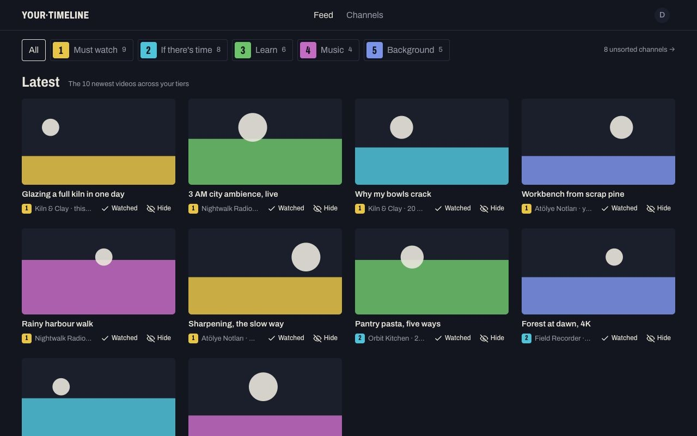
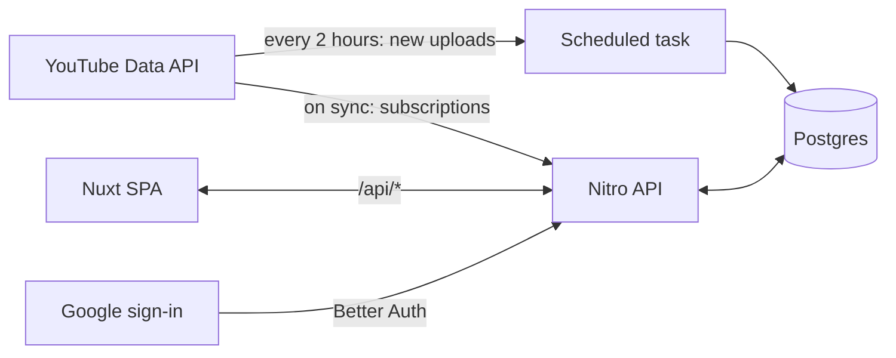
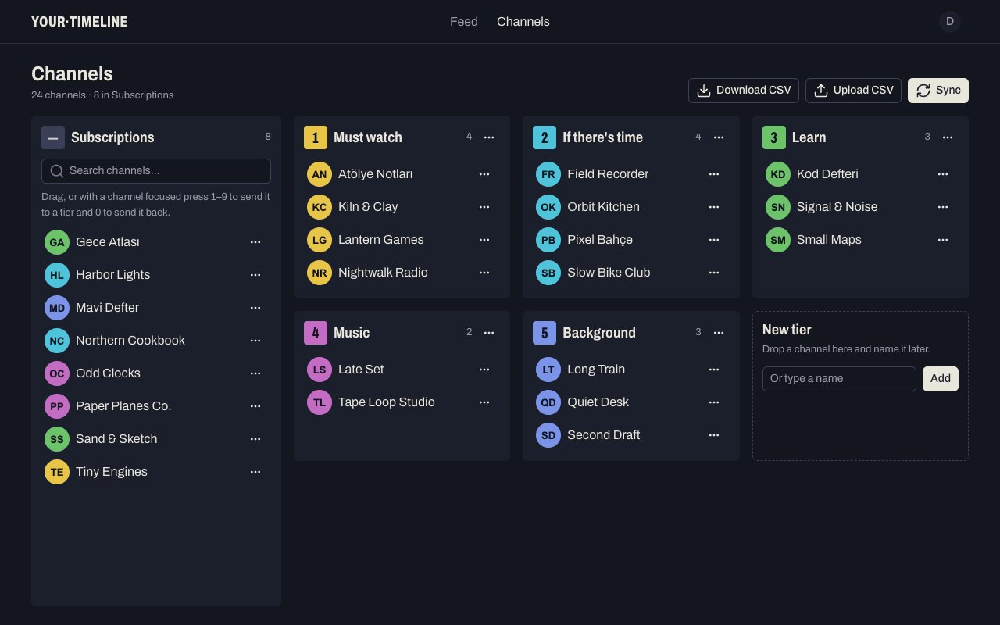
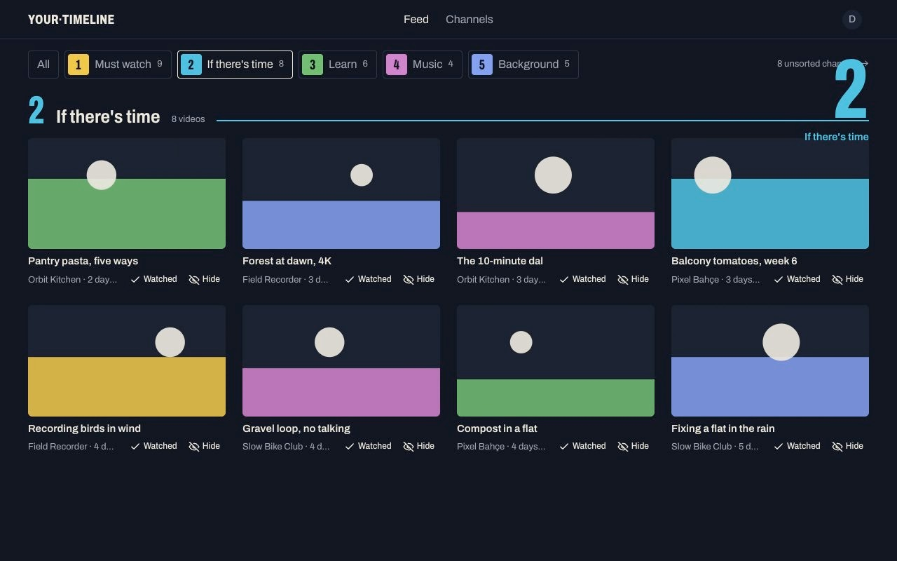
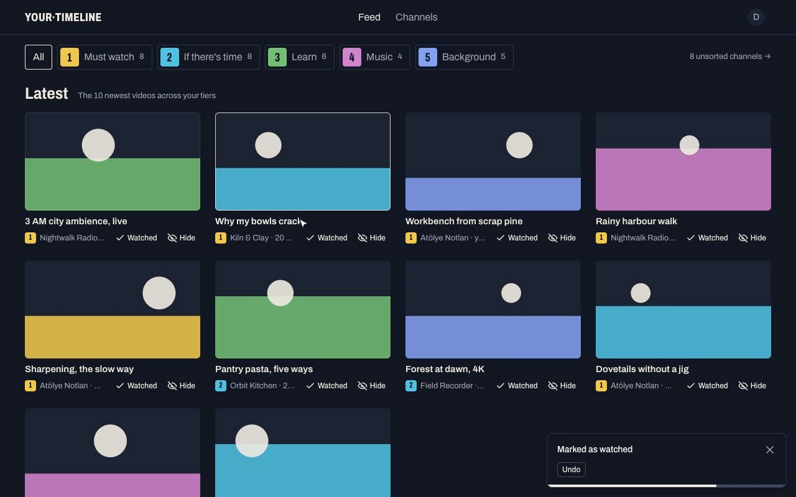
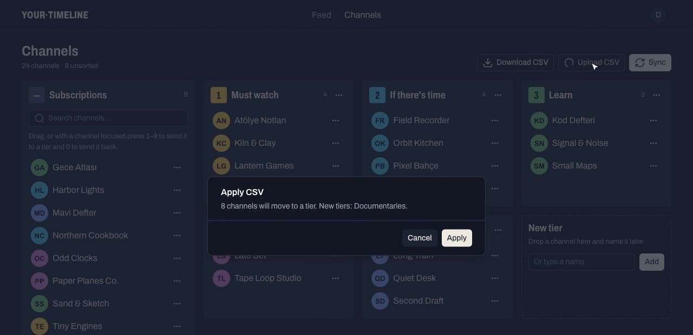

# Your Timeline

**A YouTube feed in the order you choose, not the order an algorithm chooses.**

Your Timeline takes the channels you already subscribe to and lets you sort them into priority tiers you name yourself, like *Must watch* or *If there's time*. The feed follows that order. Nothing is recommended, and a video leaves once you've watched it, so the feed works as a to-watch list that actually empties out.

🔗 **Live:** [yourtimeline.vibedevs.cc](https://yourtimeline.vibedevs.cc/en/login) (English and Turkish)

> Personal project · source code is in a private repository.



---

## The idea

A subscription list treats every channel the same, and a recommendation feed decides for you. Your Timeline asks a simpler question: *of the channels you already chose, which ones matter most to you right now?*

- **The tiers are the product.** You name them and set their order. Every screen is organized around them.
- **One glance, one key.** *All* shows the 10 newest videos across your tiers, each marked with its tier. Press `1`–`9` to jump to a single tier.
- **A feed that empties out.** Leave a video halfway and it resumes where you stopped. At 90% it counts as watched and leaves the feed. Marking or hiding a video comes with an instant undo.
- **Unsorted channels wait their turn.** New subscriptions stay out of the feed until you place them, and the feed always shows how many are waiting.

## Design constraints (on purpose)

- **Read-only on YouTube.** The app asks Google only for permission to read your subscriptions. It never posts or changes anything on your account.
- **No recommendations.** A video reaches your feed only if you put its channel in a tier.
- **No Shorts.** The feed shows regular videos only, so quick clips never crowd out what you came to watch.
- **No AI inside the app.** If you'd rather not sort 200 channels by hand, you can export a CSV, let the AI assistant of your choice fill in the tier column, and upload it back. The site shows what will change before anything is applied.
- **A failed Google grant never blocks the feed.** If access expires, only syncing stops, and the app says how to reconnect.
- **Keyboard-friendly.** The whole feed can be driven from the keyboard.
- **Bilingual from the start.** Every string is available in Turkish and English.

| Key | Action |
|-----|--------|
| `1`–`9` / `0` | Open a tier / show all |
| `J` / `K` | Move between videos |
| `Enter` | Play |
| `W` / `H` | Mark watched / hide |
| `U` | Undo |
| `?` | Show shortcuts |

## How it's built

A single Nuxt application in strict TypeScript, with the API and the scheduled job in the same service.

```
app/            Nuxt 4 SPA: feed, channel board, player
server/api      Feed, tiers, channels, sync, CSV import/export, watch progress
server/tasks    Job that fetches new uploads every 2 hours
server/db       Drizzle schema and Postgres access
```

A few decisions I'm happy with:

- **Shared catalog, personal state.** Channels and videos are stored once; tiers, watch state and progress belong to each user. A channel is fetched once however many people follow it, and deleting an account removes that person's rows without touching the shared catalog.
- **Gentle on the API quota.** New videos come from a Shorts-free version of each channel's uploads playlist, at 1 quota unit per call, every 2 hours with limited concurrency. One failing channel never stops the rest. If the daily quota runs out, API calls pause until it resets and the existing feed keeps working.
- **A small rule for "watched".** Under 10 seconds doesn't count, so opening a video by accident leaves no trace. From there, progress is saved until 90%, when the video counts as watched.
- **CSV import is planned before it's written.** The same plan powers the confirmation step and the final write. The file has the last word on the channels it lists, and channels it omits stay where they are.
- **SPA with prerendered public pages.** The app itself is client-rendered, while the landing and privacy pages are prerendered in both languages so crawlers and link previews get real HTML.
- **Tokens encrypted at rest.** Google OAuth tokens are encrypted before they're stored.

### Architecture



## Tech

| Area | Choices |
|------|---------|
| Language | TypeScript, pnpm |
| Web | Nuxt 4, Vue 3, Nuxt UI 4, Tailwind CSS 4, Nuxt i18n |
| Backend | Nitro, Drizzle ORM, Zod |
| Auth | Better Auth with Google sign-in |
| Data | PostgreSQL |
| Quality | Vitest against an in-process Postgres (PGlite), ESLint |
| Infra | Hetzner + Coolify, Docker, Cloudflare DNS / proxy |

## Status

Your Timeline is live and open to anyone with a Google account. Tiers, the feed, in-app playback with resume, keyboard shortcuts and CSV import/export all work today. It's designed desktop-first.

## Where it's going

- **A proper mobile layout.** The app is built for desktop and laptop today.

## Screenshots

All screenshots use demo data. The channels and videos are made up.

**The channel board: sort your subscriptions**



Drag channels from your subscriptions into tiers, or focus a channel and press a number key.

**A single tier**



Switching tiers works like changing a TV channel: the number flashes on screen, and only that tier's videos remain, newest first.

**Watched, with undo**



Watched videos leave the feed right away, and undo is one key away.

**CSV import: review before applying**



Upload a sorted file and see exactly what will move before you confirm.

---

<sub>Your Timeline is an independent personal project and is not affiliated with, endorsed by, or sponsored by YouTube or Google. YouTube is a trademark of Google LLC. [Privacy Policy](https://yourtimeline.vibedevs.cc/en/privacy)</sub>
